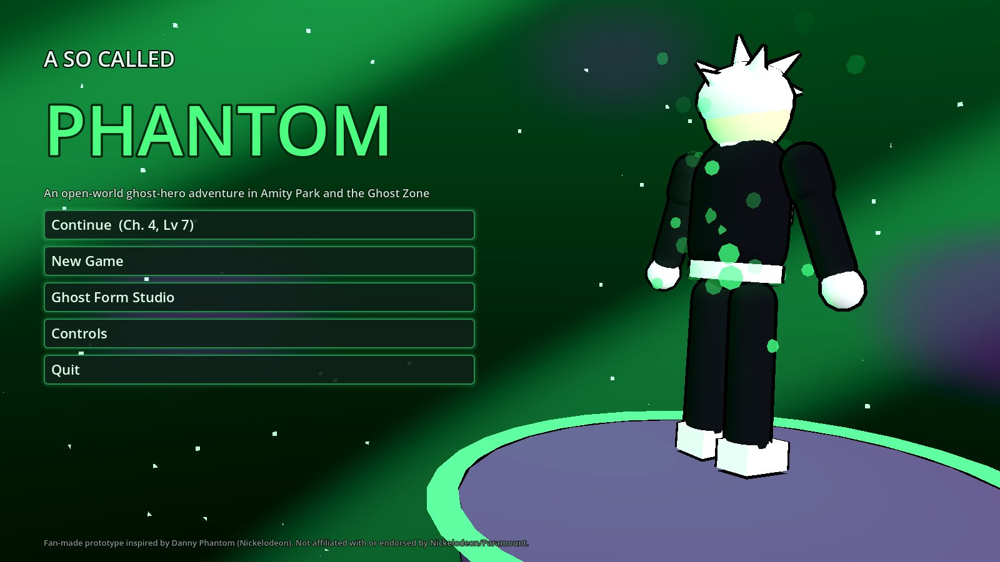
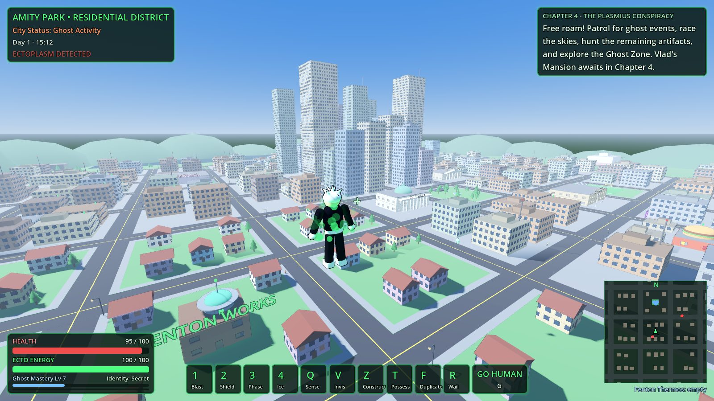
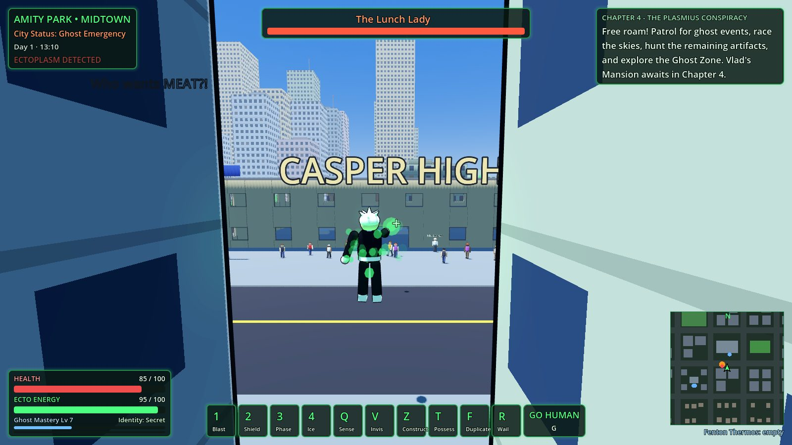
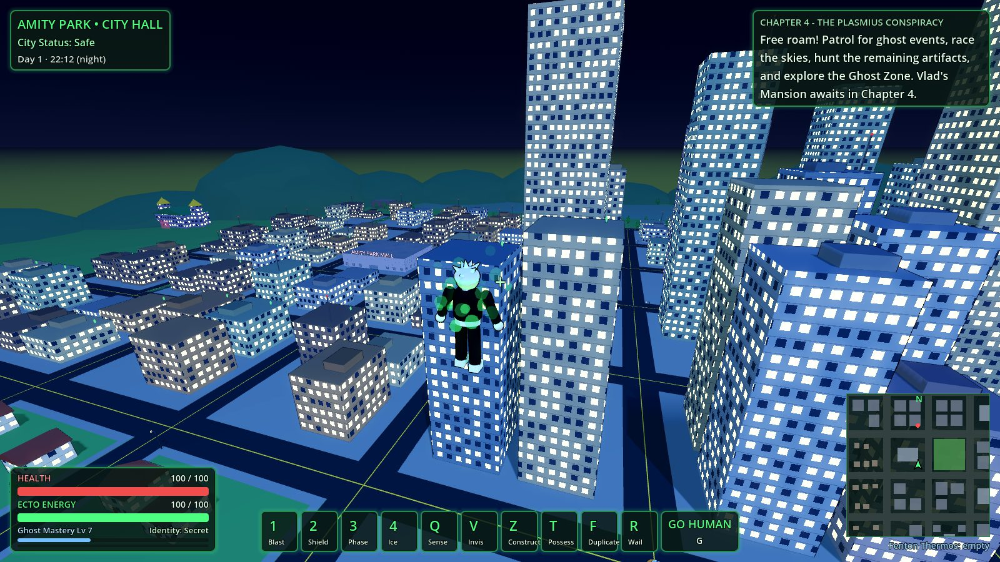
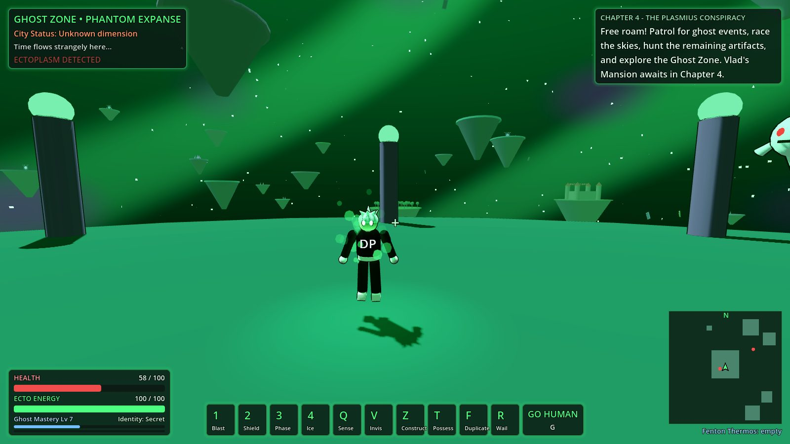
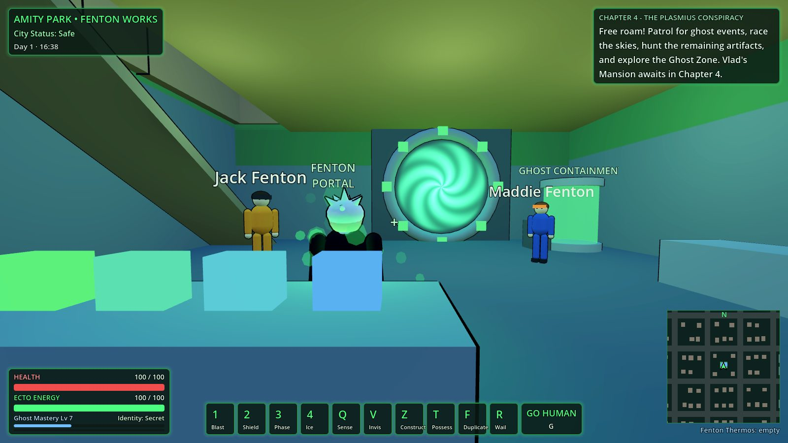
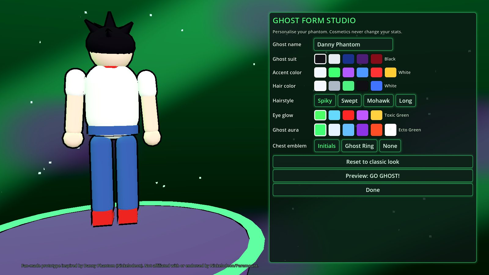

# A So Called Phantom

An open-world, third-person ghost-hero action adventure built in **Godot 4.3**.
You can explore Amity Park as a regular teenager, go ghost whenever you want, fly
across the city, phase through walls, fight and capture ghosts, and dive
into the Ghost Zone through the Fenton Portal. You can also customise your
ghost form however you like.



| Amity Park | Boss fight at Casper High |
|---|---|
|  |  |
| **Night falls** | **The Ghost Zone** |
|  |  |
| **Fenton Lab: the transformation** | **Ghost Form Studio** |
|  |  |

> **Fan project notice:** this is a non-commercial fan prototype inspired by
> *Danny Phantom* (Nickelodeon / Paramount). The characters, names and places
> belong to their owners. You would need a licence to publish it, or you
> could re-theme it as an original ghost hero.

## Download

Ready-to-play **Linux** and **macOS** builds are on the [Releases page](https://github.com/NyteRyzer/dpgame/releases).
On macOS the app isn't notarized: right-click the app, choose **Open**, then **Open** again on first launch.

New releases are built automatically by `.github/workflows/release.yml` when a `v*` tag is pushed.

## Running from source

1. Install **Godot 4.3 or newer** (standard build, no .NET needed) from <https://godotengine.org>.
2. In the Godot Project Manager click **Import**, then pick this folder's `project.godot`.
3. Press **F5** (Run Project).

You can also run it from the command line with `godot --path .`.

The project uses the **Compatibility (OpenGL 3)** renderer, so it runs on modest
PCs, laptops and integrated GPUs. Every model, building and effect is generated
in code from primitives, so there are no asset files to import.

## Controls

| Input | Action |
|---|---|
| WASD / left stick | Move. In flight you move toward where the camera looks. |
| Mouse / right stick | Camera |
| Space | Jump. In ghost form it takes off, and holding it climbs. |
| C or Ctrl | Descend. Touch the ground while descending to land. |
| Shift | Sprint, or boost while flying |
| Alt | Aerial dodge (brief invulnerability) |
| **G** | **GO GHOST / GO HUMAN**. Standing still plays the full cinematic transformation; moving plays a quick one. |
| Left mouse / 1 | Ecto blast. In human form it fires the Fenton wrist ray. |
| Right mouse | Aim over the shoulder |
| 2 / 3 / 4 | Ghost Shield / Intangibility / Cryokinesis |
| Q / V | Ghost Sense / Invisibility |
| Z / T / F / R | Ecto Construct / Overshadow / Duplicate / Ghostly Wail |
| B | Ghost Tail form (while flying) |
| E (hold) | Talk, interact, and capture weakened ghosts with the **Fenton Thermos** |
| M | Map |
| Esc / Tab | Fenton OS menu |

Gamepads work too: Y transforms, A flies, X interacts, the triggers fire and aim, and the shoulder buttons are shield and phase.

## What's in this build

### The open world: Amity Park
- A city grid about 1.2 km across. It has downtown skyscrapers, midtown blocks, residential streets, sidewalks, street lamps and distant hills.
- **Fenton Works** is fully built:
  - Danny's bedroom, where a new game starts.
  - Jazz's room, the living room and the kitchen.
  - The basement **lab**, with the working **Fenton Portal**, the ghost containment unit and the weapons vault.
  - The rooftop **Ops Center**, whose computer saves your game.
- Landmarks with interiors you can enter through doors, windows, or by phasing through the walls:
  - **Casper High**, including the cafeteria and lockers, with a sports field next door.
  - **Nasty Burger**, with the giant burger on the roof.
  - **City Hall**, **Amity Park Museum**, **Axion Labs** and the **Amity Park Mall**.
- Areas you can explore from the outside:
  - **Lake Eerie**, with woods, a cabin, a cave and a hidden rift.
  - The **Guys in White HQ**, behind an anti-ghost perimeter and guarded by agents.
  - **Vlad's estate**, sealed by a ghost shield until Chapter 4.
- **A living city:**
  - A day/night cycle where windows light up and street lamps glow at night.
  - Traffic that stops for people and panics near fights.
  - Civilians who walk the sidewalks, flee ghosts, and recognise your ghost name and cheer.
  - Casper High runs a school schedule: the bell rings at 8:00 and 15:00, and students gather outside during school hours.

### The transformation and the full power set
- Human mode lets you run, jump and talk to people without drawing attention. You can also use the Fenton wrist ray and the Fenton Thermos.
- The signature transformation: two glowing rings split from the waist and sweep to the head and feet. Each body part changes as a ring passes it, and the change ends in an ectoplasm burst.
- All 12 powers:
  - Flight, with momentum, boost, dodge, speed lines and a dynamic field of view. It never costs energy.
  - Ecto Blasts.
  - Invisibility.
  - Intangibility. You can only phase through walls marked as phaseable, and ghost-shielded walls block you. You can't solidify while you're inside a wall.
  - Ghost Shield.
  - Ghost Sense.
  - Overshadowing a civilian.
  - Ecto Constructs: platforms and walls.
  - Ghost Tail.
  - Cryokinesis: freezing enemies and building ice structures.
  - The **Ghostly Wail** ultimate: a charge-up, screen shake and shockwaves, after which your energy is drained.
  - Duplication: clones that fight alongside you.

### Ghost Form Studio
You can personalise your phantom from the title screen or the in-game menu:
- Ghost name, which civilians shout and which appears as the chest-emblem initials.
- Suit colour (5) and accent colour (6).
- Hair colour (5) and hairstyle: Spiky, Swept, Mohawk, or Long (unlocked by reputation).
- Eye glow (5).
- Aura (6, including Prismatic, unlocked by reputation).
- Chest emblem.

The preview updates live and can play the transformation, and your choices are saved. Cosmetics never change your stats.

### The Ghost Zone: a second open world
A swirling green void of floating islands and drifting doors. Its regions are:
- The Phantom Expanse hub, where the portal home is.
- The Far Frozen, with Frostbite and snowfall.
- Walker's Prison, with ghost-shielded walls, watchtowers and guards.
- Skulker's Island, Pariah's Keep (sealed endgame), Clockwork's tower, Ghost Writer's Manor and Aragon's Kingdom.

Doors and hidden rifts link the two worlds.

### Enemies and bosses
- **Regular enemies:** roaming ghosts, night shadow ghosts, Walker's guards, Mystery Meat minions, hacked drones, and Guys in White agents.
- **Capturing ghosts:** a weakened ghost gets a yellow swirl. Hold E to capture it with the Fenton Thermos (the beam pulls it in), then empty the thermos into containment at Fenton Works.
- **Four bosses**, each with its own attacks and a phase 2:
  - **Lunch Lady:** meat barrages and minion summons. In phase 2 she grows and adds ground slams.
  - **Box Ghost:** box volleys and teleport blinks.
  - **Skulker:** circles at high speed and fires homing rockets and nets. In phase 2 he adds a minigun and flare rings.
  - **Walker:** goo volleys that slow you, and he calls in guard reinforcements.

### Story mode: *The Fractured Portal*
1. **Going Ghost.** Wake up, meet Jack in the lab, go ghost, fly to the Ops Center, then defeat and capture the Lunch Lady at Casper High.
2. **Amity Under Attack.** Meet Sam and Tucker at the Nasty Burger, stop the downtown invasion, beat the Box Ghost at the mall and Skulker on the Axion Labs tower. This unlocks the Specter Deflector.
3. **Into the Ghost Zone.** Go through the portal, train with Frostbite to learn Cryokinesis, infiltrate Walker's Prison and capture Walker.
4. **The Plasmius Conspiracy.** This chapter is set up but not built yet. After Chapter 3 the game continues in free roam.

NPC dialogue changes with your story progress and your stats.

### Sandbox and free roam
- **Event director:** random city events start on their own:
  - Ghost Invasion
  - Portal Emergency: destroy the rift.
  - Skulker's Hunt
  - Ember's Concert (night only): the crowd is hypnotised until you destroy the amplifiers.
  - Guys in White Raid
  - Technus Takeover: hacked cars chase you, and the city loses power until you destroy the hacked machines.
  - Night Terrors
- **Aerial race:** fly through 9 checkpoint rings over downtown. Your best time is saved.
- **Collectibles:** 27 ectoplasmic artifacts on rooftops, in interiors and on Ghost Zone islands.
- **Location discovery** across both worlds.
- **Secret identity:** transforming in front of witnesses raises suspicion. At high suspicion the Guys in White come after you. Suspicion fades over time, so the mechanic is forgiving.

### Progression
- **Ghost Mastery:** XP and levels unlock Constructs at level 2, Overshadow at 3, the Wail at 4 and Duplication at 5.
- **Fenton Technology:**
  - Thermos.
  - Ecto Scanner (collect 5 artifacts): doubles Ghost Sense range and shows artifacts on the map.
  - Specter Deflector (25% less damage).
  - Fenton Booster (faster energy regeneration).
- **Hero Reputation:** earns cosmetic unlocks.
- Progress auto-saves at story milestones, after events, and at the Fenton Ops Computer.

### HUD and menus
- The HUD:
  - Location and city status, the clock, and an "ECTOPLASM DETECTED" alert.
  - Health and ecto-energy bars, XP, and a secret-identity meter.
  - Power slots with cooldowns, and a GO GHOST/GO HUMAN indicator.
  - A minimap and a full map (M).
  - An objective tracker, a world-space waypoint, enemy health bars, a boss bar and dialogue boxes.
- The **Fenton OS** menu has tabs for Story, Powers, Ghost Form, Progress & Tech, Settings, Controls, and Save & Quit.

## Project layout

```
project.godot            Engine config (Compatibility renderer, GameState autoload)
scenes/                  title.tscn, game.tscn (thin; everything is built in code)
shaders/                 outline (cartoon ink), building windows, Ghost Zone sky, portal swirl
scripts/autoload/        game_state.gd: customisation, progression, input map, save/load
scripts/util/            builder.gd (geometry/material helpers), humanoid.gd
scripts/player/          player.gd (movement, flight, powers, thermos, camera), character_model.gd, clone.gd
scripts/combat/          projectile.gd
scripts/enemies/         ghost_enemy.gd, boss.gd
scripts/world/           amity_park.gd, ghost_zone.gd, pedestrian.gd, car.gd, npc.gd, portal.gd,
                         destructible.gd, artifact.gd, race.gd, interactable.gd
scripts/game/            game.gd (realms, day/night, travel, dialogue), mission_manager.gd, event_director.gd
scripts/ui/              hud.gd, minimap.gd, pause_menu.gd, customizer.gd, title.gd, ui_theme.gd
scripts/dev/             autotest.gd, autoshot.gd (developer tools)
```

## Developer tools

The automated playthrough drives the whole campaign (Chapters 1–3, every boss, travel and events) and also checks walking, stair climbing and flight physics. Run it with:

```bash
godot --headless --path . res://scenes/game.tscn -- --autotest   # exits 0 on success
```

The screenshot tour renders the views in `docs/screenshots`. It needs a display, or `xvfb-run` on Linux:

```bash
godot --path . res://scenes/game.tscn -- --autoshot=/tmp/shots
godot --path . -- --autoshot=/tmp/shots     # title screen + Ghost Form Studio
```

Both tools write a save file, so they overwrite your local progress.

## Roadmap

- Co-op multiplayer (1–12 players) using Godot's high-level multiplayer API with an authoritative server. Each player gets their own phantom, there are shared world events, and PvP arenas are optional.
- Chapters 4–5: Vlad's Mansion and Plasmius, then Dark Danny and the timeline finale. Pariah Dark as a world boss.
- More bosses: Ember, Technus, Desiree, Johnny 13 and Kitty, Spectra, Fright Knight, Undergrowth.
- Hand-made character models and animations, plus audio and music.
- A roleplay mode with Sam, Tucker, Valerie and selected ghosts as playable characters.
